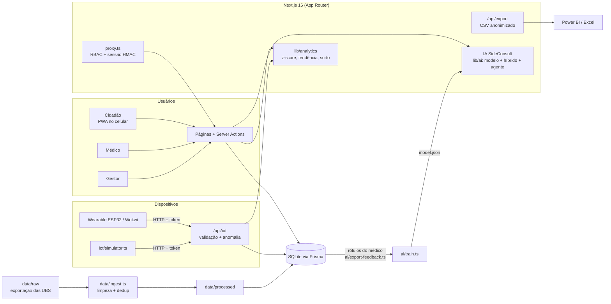

# SideConsult 🏥
### Saúde Pública Inteligente: tecnologia a serviço do bem-estar coletivo

> Plataforma que conecta **cidadão, médico e gestor** num fluxo único: triagem com **IA própria**,
> **monitoramento IoT** em tempo real, **vigilância epidemiológica** com detecção de surto e app
> **instalável no celular (PWA)**.

Global Solution 2026/2 (Substitutiva) · FIAP · Engenharia de Software

---

## 🆕 O que há de novo nesta versão (GS 2026/2)

| Área | Incremento |
|---|---|
| **1 · IA** | Modelo **SideConsult** próprio (regressão logística + TF-IDF do relato livre) treinado no projeto, sem API externa |
| | **Triagem híbrida**: regras de Manchester como piso + IA que só pode *aumentar* a prioridade |
| | **IA explicável**: mostra os fatores que mais pesaram ("fala enrolada" no relato, idade 70...) |
| | **Agente de encaminhamento**: escolhe especialidade, médico com menor fila, horário e modalidade e cria a consulta sozinho |
| | **Resumo clínico automático** para o médico + **ciclo de aprendizado** (a correção do médico vira rótulo de re-treino) |
| | **Anomalia personalizada** (z-score sobre a linha de base do próprio paciente) e **tendência** por regressão linear |
| **2 · Dados** | **Pipeline de ingestão** `data/raw → data/processed → banco` com limpeza, padronização, deduplicação e relatório de qualidade |
| | Painel do gestor com **filtros**, **série diária + média móvel**, **alerta de surto**, KPIs de IA e capacidade |
| | **Exportação CSV** anonimizada + guia de **Power BI com medidas DAX** |
| **3 · MVP/IoT** | **API IoT** autenticada por token, **simulador de wearable** e **circuito ESP32 (Wokwi)** |
| | **Monitoramento ao vivo**, alerta automático que **coloca o paciente no topo da fila do médico** |
| | **App mobile (PWA)**: instalável, navegação inferior estilo app, tela offline com atalho para o SAMU 192 |
| **Robustez** | Sessão **assinada (HMAC)**, **controle de acesso por papel** (cidadão/médico/gestor), validação nas fronteiras |
| | **LGPD**: consentimento no cadastro, CPF mascarado, **trilha de auditoria** visível ao paciente |
| | **15 testes automatizados**, **CI no GitHub Actions**, **Docker/Compose**, build de produção corrigido |

---

## 🏗️ Arquitetura



| Camada | Tecnologia |
|---|---|
| Frontend + Backend | Next.js 16 (App Router, Server Actions, Route Handlers), React 19, TypeScript |
| UI | Tailwind CSS 4, Lucide, gráficos em SVG puro (sem biblioteca) |
| Dados | Prisma ORM + SQLite (dev) · pipeline em TypeScript · CSV para Power BI |
| IA | Regressão logística multinomial + TF-IDF implementada do zero (`lib/ai`), treino em `ai/train.ts` |
| IoT | API REST + simulador Node + firmware ESP32 (Arduino/Wokwi) |
| Segurança | Sessão HMAC-SHA256, RBAC no `proxy.ts`, bcrypt, auditoria de acesso |
| DevOps | `node:test` via tsx, ESLint, GitHub Actions, Docker/Compose |

---

## 🚀 Como rodar

Pré-requisito: **Node 20+**.

```bash
npm install
cp .env.example .env          # Windows (PowerShell): Copy-Item .env.example .env
npm run setup                 # cria o banco, roda o seed e o pipeline de dados (90 dias de histórico)
npm run dev                   # http://localhost:3000
```

> `npm run setup` **apaga e recria** o banco local de desenvolvimento.

### Credenciais de demonstração (senha `123456`)

| Perfil | E-mail | Onde cai |
|---|---|---|
| Cidadã com wearable IoT (Maria, 68 anos, hipertensa) | `maria@teste.com` | `/portal` |
| Médica (Clínica Geral) | `medico@saude.gov` | `/doctor-dashboard` |
| Gestor (vê o painel epidemiológico) | `gestor@saude.gov` | `/management` |
| Outros médicos | `cardio@`, `pneumo@`, `infecto@saude.gov` | `/doctor-dashboard` |

### Todos os comandos

| Comando | O que faz |
|---|---|
| `npm run iot:sim` | Simula o wearable da Maria enviando leituras a cada 3s |
| `npm run iot:sim -- --crise 5` | Após 5 leituras normais, simula uma crise (pressão sobe, SpO2 cai) |
| `npm run data:pipeline` | Gera a exportação "suja" das UBS e roda a ingestão |
| `npm run ai:dataset` / `npm run ai:train` | Gera o dataset e treina o modelo (atualiza `lib/ai/model.json` e `ai/REPORT.md`) |
| `npm run ai:feedback` | Exporta as gravidades confirmadas pelos médicos para re-treino |
| `npm test` | 15 testes (IA, analytics, ingestão, sessão) |
| `npm run lint` / `npm run build` | Lint e build de produção |
| `docker compose up --build` | Sobe tudo em container (`--profile iot` também sobe o simulador) |

### 🎬 Roteiro de demonstração (pitch)

1. Entre como **Maria** → **Triagem**: marque *Dor de cabeça*, idade 70, relato *"fala enrolada e boca torta"*.
   As regras dariam **nível 1**; a IA lê o relato e sobe para **nível 5**, mostrando os fatores e o agente encaminhando para a UPA.
2. Faça uma triagem leve (*Dor de garganta*): o **agente agenda sozinho** uma telemedicina com o médico de menor fila.
3. Abra **Diário de Saúde** e rode `npm run iot:sim -- --crise 5`: os gráficos atualizam ao vivo e, na piora, o alerta dispara.
4. Entre como **médica**: a Maria aparece com selo **ALERTA IoT** no topo da fila; abra o atendimento e veja o **resumo clínico automático**. Ao finalizar, confirme/corrija a gravidade (rótulo para re-treino).
5. Entre como **gestor**: **alerta de surto** de febre na Zona Leste, filtros, série diária, concordância IA × médico e exportação para Power BI.
6. No celular (ou DevTools em modo mobile), **instale o app** e navegue pela barra inferior.

---

## 🧠 Área 1: IA, automação e sistemas inteligentes

**Problema:** a triagem por regras olha só os sintomas marcados. Um idoso com dor de cabeça que escreve
*"fala enrolada"* (sinal de AVC) recebe prioridade mínima.

**Solução: IA própria + regras como piso de segurança**

- `lib/ai/sideconsult-model.ts`: featurização (6 sintomas, dor, idade, faixas idoso/criança, **TF-IDF do relato**),
  inferência (softmax) e **explicação** (contribuição de cada fator para a classe escolhida).
- `ai/train.ts`: treino por gradiente descendente com regularização L2 e pesos por classe; exporta `lib/ai/model.json`.
- `lib/ai/hybrid.ts`: `gravidade = max(regras, IA)`. **A IA nunca rebaixa** um caso (garantido por teste).
- `lib/ai/scheduling-agent.ts`: **agente** perceber → decidir → agir, com cada passo exibido ao cidadão.
- `lib/clinical-summary.ts`: resumo clínico automático (automação cognitiva) para o médico.
- **Ciclo de aprendizado:** o médico confirma ou corrige a gravidade → `npm run ai:feedback` → `npm run ai:train`.

**Ganho medido** (conjunto de teste, detalhes em [`ai/REPORT.md`](ai/REPORT.md)):

| Abordagem | Casos graves (4-5) que passaram como não graves | Sub-triagem |
|---|---|---|
| Só regras | **20,1%** | 36,9% |
| Híbrido SideConsult (em produção) | **6,0%** | 5,1% |

O híbrido aceita mais **sobre-triagem** (priorizar demais), que é o lado seguro do erro na saúde.

---

## 📊 Área 2: Big Data, dados e visualização

**Modelo de dados** (`prisma/schema.prisma`): `User` (papéis), `Triage` (gravidade de regras/IA/médico, origem APP/IOT/IMPORT, região),
`HealthRecord` (sinais vitais, origem manual/dispositivo), `Device`, `Appointment`, `Vaccine`, `HealthUnit`, `AccessLog`.

**Pipeline de ingestão** (camadas de data lake):

```
data/raw/atendimentos_ubs.csv  →  data/ingest.ts  →  data/processed/triagens_padronizadas.csv  →  banco
 (";", dd/mm/aaaa, "Z. Leste",      parse, validação,     + quality_report.json
  duplicatas, linhas inválidas)     normalização, dedup
```

Exemplo de execução: 2.451 linhas lidas, 68 duplicadas removidas, 4 inválidas descartadas (com o motivo), 2.379 carregadas.

**Painel do gestor** (`/management`):
- Filtros por **período, região, gravidade mínima e origem** (form GET: URL compartilhável).
- KPIs: atendimentos, % emergências, casos graves, alertas IoT, **casos em que a IA elevou a prioridade**,
  **concordância IA × médico**, **espera média** (triagem → atendimento).
- **Série diária com média móvel de 7 dias**, distribuição de risco, sintomas mais comuns e tabela por região.
- **Alerta de surto**: casos de um sintoma numa região > 2× a média dos 7 dias anteriores (mínimo de 8 casos).
- **Exportação CSV anonimizada** → Power BI. Medidas DAX prontas em [`docs/POWERBI.md`](docs/POWERBI.md).

---

## 📱 Área 3: MVP full stack, IoT e experiência digital

**Telas:** landing · triagem com IA · login/cadastro (cidadão e médico) · portal do cidadão · agendamento ·
histórico e receitas · carteira de vacinação · campanhas · unidades de saúde · **diário de saúde ao vivo** ·
painel clínico · atendimento com resumo e parecer da IA · histórico do médico · **painel epidemiológico** · offline.

**IoT:**
- `POST /api/iot` (header `x-device-token`): valida faixas fisiológicas, grava a leitura e detecta
  **limites críticos** (SpO2 < 90%, PA ≥ 180...) e **desvios do padrão do próprio paciente**
  (linha de base = leituras com mais de 30 min, para a crise não "normalizar" a média).
  Em alerta, cria/eleva uma triagem `IOT` que entra no topo da fila do médico (sem duplicar alertas).
- `iot/simulator.ts`: wearable simulado com modo crise.
- `iot/esp32/`: firmware (`sketch.ino`) e circuito (`diagram.json`) para o **Wokwi**: potenciômetros simulam
  SpO2/FC/PA, botão de crise e LED de alerta. Como o Wokwi roda na nuvem, a API precisa de URL pública (ex.: `ngrok http 3000`).

**Mobile (PWA):** manifest com ícones gerados no servidor, atalhos (Triagem/Diário), botão **Instalar app**,
**barra de navegação inferior** no celular, layouts revisados em 375px sem rolagem horizontal e service worker
(produção) que **não guarda dados de saúde em cache**, só a tela offline com atalho para o **SAMU 192**.

---

## 🔐 Segurança e LGPD

- **Sessão assinada (HMAC-SHA256)** com expiração. Antes o cookie guardava o ID do usuário em texto puro e bastava trocá-lo para acessar outro prontuário.
- **RBAC central** em `proxy.ts` + checagem nas Server Actions: cidadão não acessa área médica; só o gestor vê o painel e exporta dados.
- Mensagem de login genérica (não revela se o e-mail existe), validação de entrada em todas as fronteiras (triagem, IoT, cadastro, sinais vitais).
- **LGPD:** consentimento obrigatório no cadastro, CPF mascarado na tela do médico, exportação sem dados pessoais,
  **trilha de auditoria**: o paciente vê no portal quem abriu o prontuário dele e quando.

## 🧪 Qualidade e DevOps

- `npm test`: 15 testes com `node:test` (IA nunca rebaixa, sinal de alarme eleva, z-score, regressão, surto, ingestão, sessão adulterada).
- CI (`.github/workflows/ci.yml`): instala, migra, lint, testes, seed + pipeline (smoke) e build.
- `Dockerfile` + `docker-compose.yml` (app + simulador IoT opcional).

## ⚠️ Limitações (transparência)

- O modelo foi treinado com **dados sintéticos** baseados em sinais de alarme clínicos; **não é validado clinicamente**.
  O pipeline de re-treino com rótulos reais dos médicos já existe.
- SQLite é para desenvolvimento; em produção, PostgreSQL (troca de `provider` no Prisma).
- O cadastro de médicos é aberto, por ser um MVP; em produção exigiria validação do CRM.
